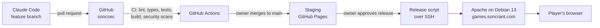

# Star Destroyer and Games Portal — Architecture

> **Status:** ADR-001 to ADR-011 accepted or decided by owner 2026-10-17. ADR-012 is **Proposed**.

## 1. Overview

Both the games portal and Star Destroyer are **static websites**: HTML, JavaScript and image/audio files with **no backend**. They are served by the existing Apache server on Debian 13. There is no server-side code to run, patch, or secure beyond the web server itself, and no user data leaves the browser.



### Production layout

| URL | Served from | Source repo |
|---|---|---|
| `games.soncrant.com/` | `/var/www/html/soncrant.com/pub/games/` | `soncsec/games-portal` |
| `games.soncrant.com/star-destroyer/` | `/var/www/html/soncrant.com/pub/games/star-destroyer/` | `soncsec/star-destroyer` |

Each future game gets its own repo and its own subfolder under `games/` (owner approved 2026-10-17). Apache serves the site over HTTP on TCP port 80.

The `games/` folder sits inside `soncrant.com`'s `pub/` folder, so the same files may also be reachable at `soncrant.com/games/`. Builds therefore use relative paths so they work at either address.

## 2. Architecture decisions

### ADR-001: Static sites, no backend — *Accepted*

- **Context:** single player, no accounts, no payments, no data collected.
- **Decision:** ship static builds. The high score is stored in the browser's localStorage.
- **Alternatives:** a Node or serverless backend (needed only for online leaderboards or accounts, both out of scope).
- **Tradeoffs:** the simplest option with no operating cost and very little attack surface. Adding online features later would need a new ADR.

### ADR-002: Game engine — Phaser — *Accepted*

| | **Phaser** (chosen) | PixiJS | Plain Canvas |
|---|---|---|---|
| Scope | Full 2D game framework | Renderer only | Nothing built in |
| Built-in features | Sprite-sheet animation, arcade physics and collisions, input, audio, scenes, object pooling | Animation; physics, input and audio must be built or added | Everything hand-written |
| Implementation effort | Low | Medium | High |
| Maintainability | Well-known conventions, large example library | Custom glue code | All custom |
| Cost | About 1 MB library; we follow its structure | More code to own | Most code, most bugs |

- **Decision:** Phaser **4.2.1**, pinned exactly. v4 has been the stable line since April 2026 (4.0.0); 4.2.1 was released 2026-07-09. v3 is no longer the `latest` release on npm.

### ADR-003: Language — TypeScript — *Accepted*

- **Version:** TypeScript **6.0.3**. TypeScript 7 is out, but typescript-eslint 8.71 only supports TypeScript below 6.1, so we stay on 6.0 until the linter supports 7.
- **Alternatives:** plain JavaScript.
- **Tradeoffs:** a small setup cost (handled by Vite) buys compile-time error checking, safer refactoring, and easier PR review.

### ADR-004: Build tool — Vite — *Accepted*

- **Alternatives:** no bundler (native ES modules plus a CDN-hosted Phaser).
- **Tradeoffs:** Vite gives a dev server with live reload, TypeScript support, and a small optimized `dist/` folder, and it bundles dependencies locally. No runtime CDN means a strict CSP works.
- **Note:** builds use a relative base (`base: './'`) so the game works at `games.soncrant.com/star-destroyer/` and at `soncrant.com/games/star-destroyer/`.

### ADR-005: Hosting — *Accepted*

- **Staging:** every merge to `main` auto-deploys to GitHub Pages for play-testing. URL: https://soncsec.github.io/star-destroyer/. The `Staging` workflow deploys only commits on `main` that passed CI, and then runs a ZAP baseline scan (2.17.0) that fails on any high-risk alert. GitHub Pages can't set custom headers, so header warnings (CSP and others) are expected there; Apache sets them in production (P1.6).
- **Production:** the existing **Apache** on Debian 13, public on the internet, serving HTTP on TCP port 80. Files go under `/var/www/html/soncrant.com/pub/games/`, with one subfolder per game. Existing sites stay untouched. The owner maps `games.soncrant.com` to this folder in Apache; Claude does not change the Apache configuration.
- **Alternatives:** installing nginx alongside Apache (rejected because two web servers would conflict over port 80); itch.io or Netlify (rejected because the owner wants their own server).

### ADR-006: Testing approach — *Accepted*

- **Decision:** keep game rules (damage, scoring, wave schedule, weapon levels, boss phases) in plain TypeScript modules with no Phaser dependency, and unit test them with **Vitest**. Phaser scenes stay thin. Run end-to-end tests in real browsers with **Playwright**, using a test-only hook that exposes game state. Use a **seeded random number generator** so test runs are reproducible.
- **Alternatives:** manual play-testing only (unreliable), or screenshot comparison only (brittle).

### ADR-007: Security tooling — *Accepted*

| Check | Tool | When |
|---|---|---|
| Static analysis | CodeQL; ESLint | Every PR |
| Dependency vulnerabilities | `npm audit`, Dependabot | Every PR, plus weekly |
| Secrets in code | Gitleaks | Every PR |
| Dynamic scan of the running site | OWASP ZAP baseline | Staging after each deploy; production before and after each release |
| HTTP security headers | CSP, `X-Content-Type-Options`, `Referrer-Policy`, `Permissions-Policy`, `X-Frame-Options` | Apache `mod_headers`, scoped to the `games/` folder (vhost config or `.htaccess`, confirmed in P1) |

### ADR-008: Games portal — static site from a data file, separate repo — *Accepted*

- **Decision:** the portal is its own repo (`soncsec/games-portal`), built with Vite and TypeScript. One `games.json` file lists each game (slug, title, summary, image, tags, status), and the home page renders a card per entry. Retro-arcade visual style. No framework (React and similar) is needed for a single card grid.
- **Alternatives:**
  - An admin UI for adding games (rejected: needs a backend, logins and their security work).
  - A monorepo holding the portal and all games (rejected for now: separate repos keep each game independent and its CI fast; can revisit once there are several games).
  - A static site generator such as Astro or Eleventy (rejected for now: more tooling than one page needs).
- **Tradeoffs:** adding a game means a small PR to `games.json` plus a card image, which is simple and reviewable.

### ADR-009: Production deployment — release script over SSH — *Accepted*

- **Decision:** `scripts/release.sh` in each repo builds a tagged version, runs the checks, and copies `dist/` to the server over SSH into a new release folder. It then switches a symlink to the new folder, which makes the switch atomic and the rollback a single command. Claude runs it only with the owner's approval for each release, or the owner runs it.
- **Server layout:** each release is uploaded next to the live folder and swapped in by rename (`<slug>.new` → `<slug>`, keeping `<slug>.prev` for rollback). Old copies are blocked from being served. If the owner allows a folder outside `pub/`, releases are stored there and linked in instead. Settled in P1.
- **Server setup:** a dedicated `deploy` user that can write only to `/var/www/html/soncrant.com/pub/games/`, using key-based SSH with no password login. Apache config changes are made by the owner or with the owner's approval through sudo.
- **Alternatives:** automatic deploys from GitHub Actions (rejected for now because it would store a server SSH key in GitHub); manual copying (error-prone, no rollback).

### ADR-010: HTTP on port 80 — *Decided by owner 2026-10-17*

- **Decision:** the games site is served by Apache over HTTP on TCP port 80.
- **Owner's reason:** the server uses self-signed certificates, which browsers would warn about, and the site handles no sensitive data.
- **Claude's recommendation on record:** HTTPS. On a public site, plain HTTP lets any network between a player and the server alter the game's files in transit, and browsers label the page "Not secure".
- **Mitigations while on HTTP:** no logins, forms or personal data on the site; strict CSP and other security headers; no third-party scripts.
- **Revisit if:** the site ever adds logins, payments or online scores, or the owner moves to a publicly trusted certificate (for example free Let's Encrypt certificates via certbot).

### ADR-011: Parallel Claude instances building other games — *Accepted 2026-10-17*

- **Context:** the owner wants several Claude Code sessions building different games at the same time, without interfering with each other.
- **Decision:** isolate by design, so instances never share a file, branch, server folder or port.

| Shared thing | How collisions are prevented |
|---|---|
| Code | One repo per game (`soncsec/<slug>`), one local folder per game (`~/games/<slug>/`), one Claude session per folder |
| Starting point | A GitHub **template repo**, `soncsec/game-template`, extracted from Star Destroyer after M1 and P1 prove the setup. It contains the Vite + TypeScript + Phaser scaffold, CI and security checks, test setup, release script, CLAUDE.md and doc skeletons. A new game is `gh repo create soncsec/<slug> --template soncsec/game-template`. |
| Game name and URL | Claimed by a PR to the portal that adds `games/<slug>.json` with status `in-development`. The portal reads one file per game, so two instances never edit the same file. The first merged PR owns the slug. |
| Portal code and Apache config | Owned only by the portal repo. Game instances never change the Apache config, the portal, or another game. |
| Production server | Each game's release script writes only to `/var/www/html/soncrant.com/pub/games/<slug>/`. The script refuses any other target. |
| Local dev ports | Each game's entry records its own Vite dev port (Star Destroyer 5173, then 5174, 5175, …) so dev servers can run side by side. |
| Art source | `legacy/` is shared and read-only. Each game copies the assets it uses into its own repo. |
| Rules and conventions | Each repo's CLAUDE.md comes from the template and includes a scope rule: change only this repo. Cross-repo changes are proposed as issues on the owning repo. |

- **Alternatives:**
  - A monorepo with git worktrees per instance (rejected: shared CI, shared lockfile and a shared `main` give many more chances to collide).
  - A shared npm package for common game code (rejected for now: versioning and publishing overhead before we know what is common; revisit when a third game needs the same code).
- **Tradeoffs:** a template copies the setup once rather than sharing it live, so later improvements to the template have to be applied to each game by hand. That's acceptable for a handful of games.

### ADR-012: Data-driven levels — *Proposed 2026-10-17*

- **Context:** the owner expanded scope to 8 levels, each with a boss and its own art, with difficulty rising gradually.
- **Decision:** each level is a plain TypeScript data object in `src/levels/` (background layers, enemy roster, wave script, boss, drop rates, difficulty numbers). One shared game scene plays any level. A pure `difficulty(level)` function produces fire rates and speeds within the limits in PROJECT.md section 4a, and unit tests enforce those limits.
- **Alternatives:** one hand-coded scene per level (8× the code, and difficulty limits can't be checked centrally); an external level editor such as Tiled (extra tooling for wave scripts that are mostly timing data).
- **Tradeoffs:** a level format has to be designed up front (M4.1). In return, levels 2–8 are mostly data and art work, and adding levels later is cheap.

## 3. Proposed code structure

```
star-destroyer/                     games-portal/
├── public/assets/   (~50 sprites)   ├── public/games/  (card images)
├── src/                             ├── src/
│   ├── main.ts                      │   ├── main.ts   (renders cards)
│   ├── config/tuning.ts             │   └── styles.css
│   ├── logic/       (unit tested)   ├── games.json
│   ├── scenes/                      ├── deploy/apache/games.soncrant.com.conf
│   ├── entities/                    ├── scripts/release.sh
│   └── debug/testHook.ts            └── tests/
├── tests/unit/  tests/e2e/
├── scripts/release.sh
└── PROJECT.md ARCHITECTURE.md ROADMAP.md CLAUDE.md
```

The four planning docs live in `star-destroyer` and cover both repos. The portal repo gets a README and a CLAUDE.md that points to them.

## 4. Key technical practices

- **Pixel-perfect rendering:** Phaser `pixelArt: true`, integer scaling, and the CSS `image-rendering: pixelated` property.
- **Object pooling:** bullets, enemies and explosions are reused, not created and destroyed each time, to keep frame rate steady.
- **Asset pipeline:** each sprite sheet's frame size is recorded in one manifest file and checked in an asset-preview scene.
- **End-to-end test hook:** `src/debug/testHook.ts` exposes `window.__starDestroyer` (scene, state snapshot, spawn controls). It is loaded only in the test build (`npm run build:e2e`, `vite build --mode e2e`), which Playwright serves on port 4174. The normal build does not contain it. Tests still drive the ship with real keyboard input.
- **Dependencies:** exact versions with a committed lockfile; adding a new dependency needs owner approval. New tool versions must be at least two weeks old.

## 5. Delivery pipeline

1. Claude works on a `feature/<task>` branch and opens a PR with a change summary and test evidence.
2. CI runs format, lint, type check, unit tests, Playwright tests, build, `npm audit`, CodeQL and Gitleaks.
3. The owner reviews and merges. `main` is protected, and Claude never merges.
4. A merge to `main` auto-deploys to staging (GitHub Pages), then a ZAP scan runs against staging.
5. Production release: the owner approves → the release script runs → a ZAP scan and smoke test check production → the version is tagged.

## 6. Development environment

- Dev machine: Debian 13, with Node.js 24.21.0 LTS (via nvm) and GitHub CLI 2.102.0 installed in the user's home folder.
- The production server's address and SSH details live in an untracked local file (`deploy/server.env`, covered by `.gitignore`), never in the public repo.
